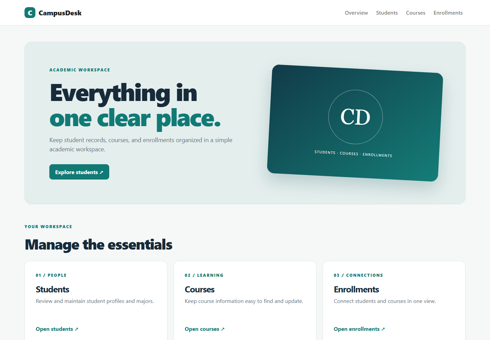
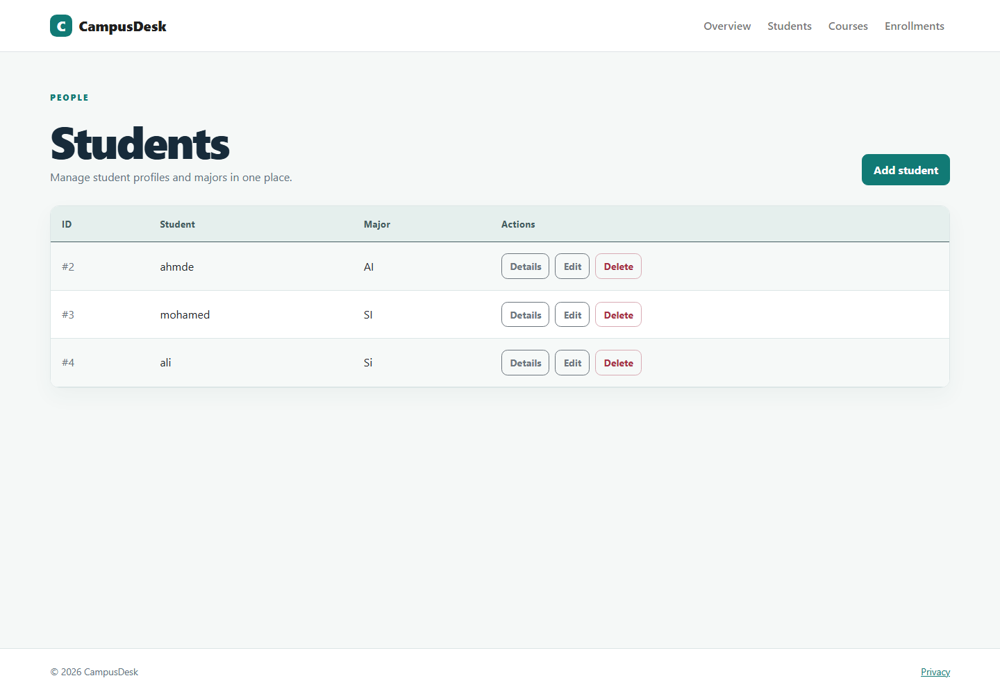

# Student Course Management System

ASP.NET Core MVC application for managing students, courses, and enrollments. It uses .NET 8, Entity Framework Core, and SQL Server LocalDB.

The interface, branded **CampusDesk**, now has a responsive overview page with direct links to each workflow, a clearer navigation bar, and polished student, course, and enrollment lists with empty states and consistent actions.

## Features

- View, create, edit, and delete student and course records.
- Manage enrollment records connecting students with courses.
- Browse each area from the top navigation.

## Run locally

Install the .NET 8 SDK and SQL Server LocalDB. From the repository root:

```powershell
dotnet restore "Student Course Management System.sln"
dotnet ef database update --project ".\Student Course Management System\Student Course Management System.csproj"
dotnet run --project ".\Student Course Management System\Student Course Management System.csproj"
```

The connection string in the app project targets `(localdb)\MSSQLLocalDB` and `StudentCourseDb`. On a fresh LocalDB instance, install `dotnet-ef` if needed and run the migration command shown above. Open the URL printed by `dotnet run`; no login is required.

## Screenshots

New screenshots captured from the running local application:





